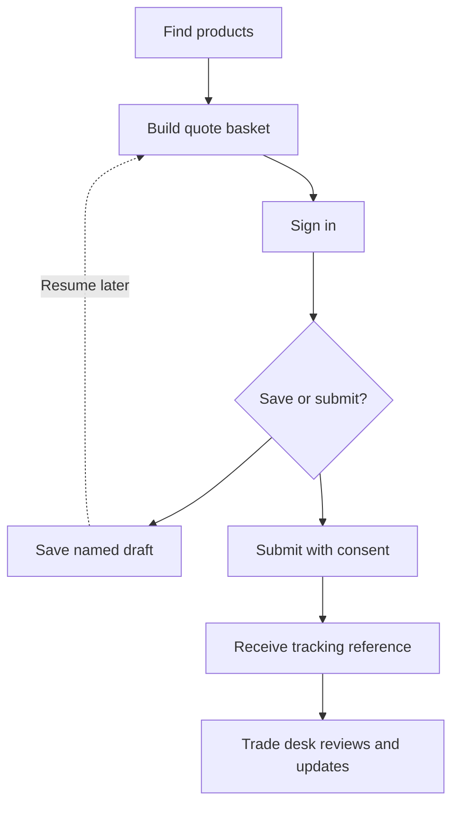
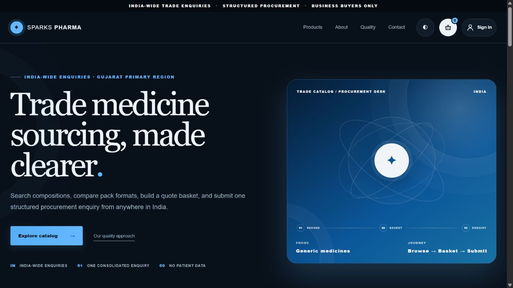
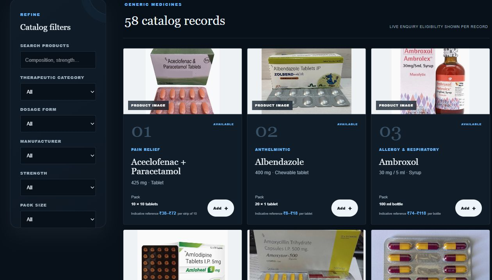
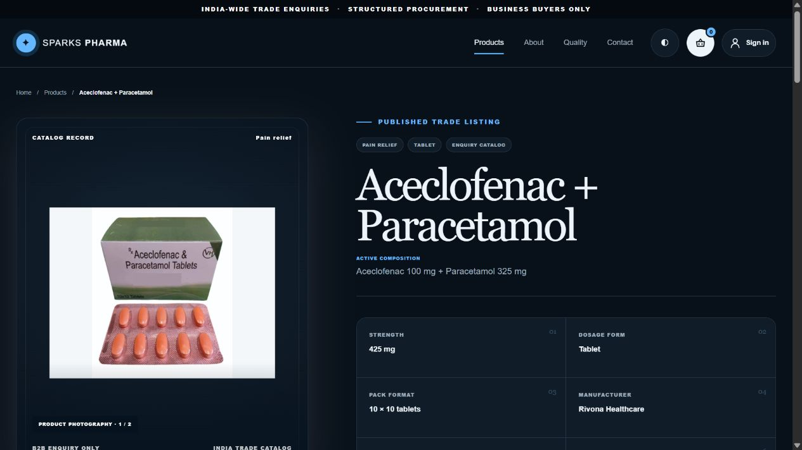
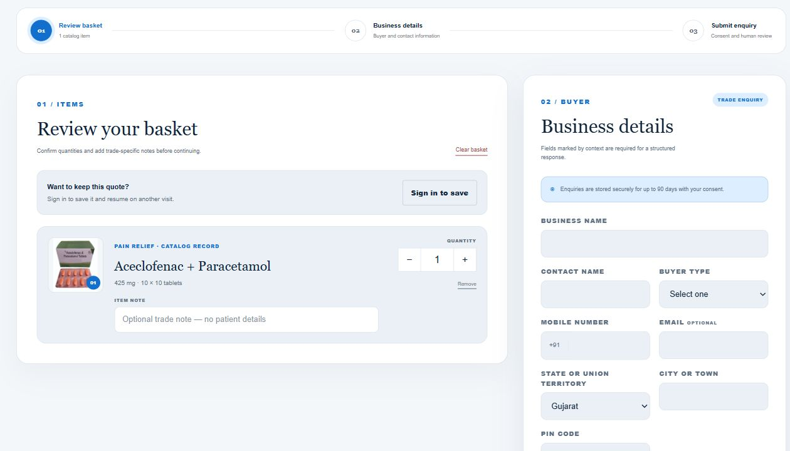
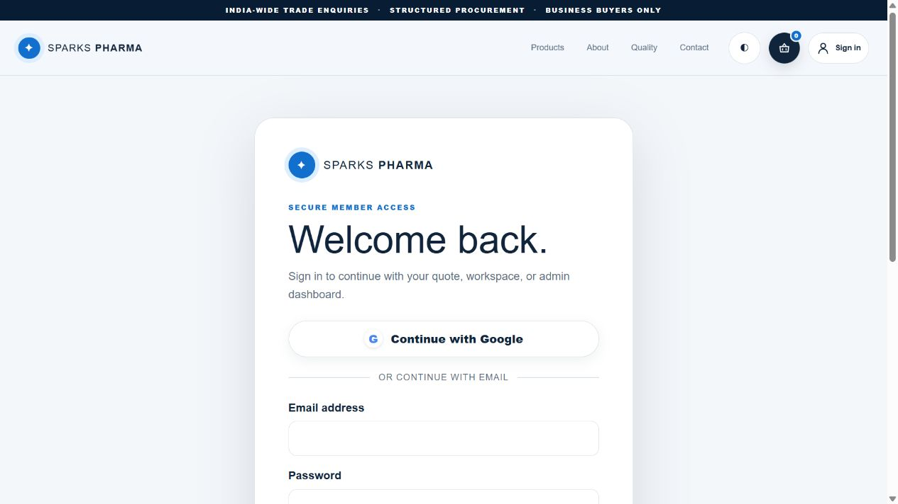
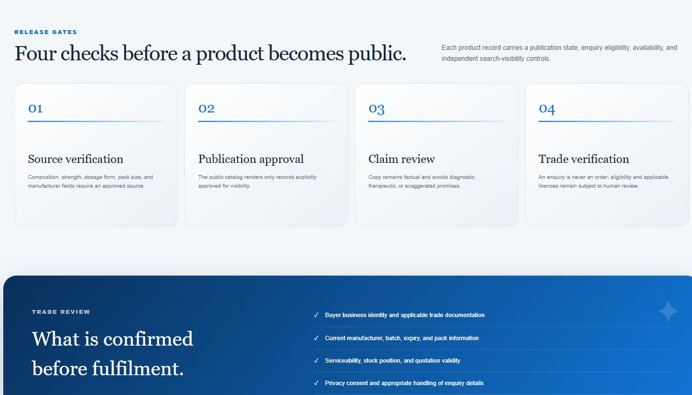
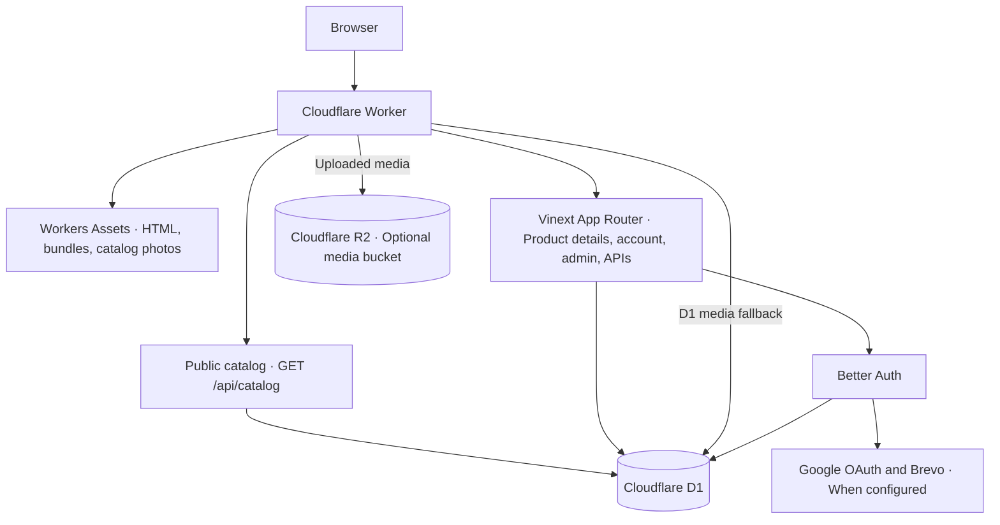

# Sparks Pharma

**A B2B pharmaceutical catalog and trade enquiry workspace built on Cloudflare Workers.**

Sparks Pharma demonstrates a procurement workflow for business buyers across India, with Gujarat as the primary service region. Buyers can compare medicine records, build a quote basket, and send one structured request for manual review. Staff manage what appears in the catalog and follow up on enquiries in a protected workspace.

[Live demo](https://sparks-pharma.tanishqchaudhary886.workers.dev/) · [Screenshots](#screenshots) · [Architecture](#architecture) · [Run locally](#run-locally) · [Deploy](#deploy-to-cloudflare-workers)

> **Portfolio demo.** Business identity and catalog records are illustrative. Prices are indicative references and trade terms are confirmed during manual review.

## What you can do

| Workspace | Capabilities |
| --- | --- |
| **Public storefront** | Search by name or composition and filter by category, dosage form, strength, manufacturer, pack size, availability, price, and enquiry eligibility. Product pages show photos, pack details, reference pricing, and trade notes. |
| **Quote basket** | Add eligible products, adjust quantities, and attach item notes. The basket persists in the browser. Sign in to save a named draft or submit an enquiry with business details and consent. |
| **Member account** | Manage a buyer profile and appearance preferences, resume saved quotes, and follow submitted enquiries using a tracking reference and status history. |
| **Admin workspace** | Manage the product lifecycle, images, and CSV import/export. Review incoming enquiries, update their status, and record internal notes or member-visible updates. Owners manage site settings and editor access. |
| **Public information** | Explore the About, Quality, and Contact pages, along with the project’s privacy and trade disclosures. |

### From catalog to enquiry



A submitted enquiry starts as **new**. Staff can record **contacted**, **qualified**, or **closed** status. The member’s tracking page shows public updates and status events.

## Screenshots

Desktop captures from the live demo. Open a pair to see the screens at full width.

<details>
<summary><strong>Storefront and catalog</strong></summary>

**Storefront** · The main entry point for browsing products and preparing an enquiry.



**Catalog** · Search, filters, and published procurement records.



</details>

<details>
<summary><strong>Product details and quote basket</strong></summary>

**Product detail** · Product photography, pack information, and a quote action.



**Quote basket** · Consolidated quantities and item notes before business details and consent.



</details>

<details>
<summary><strong>Sign-in and quality approach</strong></summary>

**Sign-in** · Entry point for saving quotes, submitting enquiries, and tracking requests.



**Quality approach** · Source verification, publication review, and trade checks.



</details>

## Architecture

Cloudflare Workers handle requests for the storefront, account area, and admin workspace. Vinext runs the Next.js App Router code on Vite. D1 stores the business records and authentication data. Product uploads use R2 when the `MEDIA` binding is configured and D1 otherwise.



### How a product reaches the storefront

1. An owner or editor saves a record in one of four states: `draft`, `review`, `published`, or `archived`.
2. The deployed Worker serves pre-rendered HTML for `/` and `/products`. This keeps full request-time rendering off the normal initial document request for those pages.
3. The browser fetches `GET /api/catalog` without using a cached response. The Worker runs a D1 query for published listings and returns a compact payload for the grid and filters. Publishing or archiving a product changes that feed without rebuilding the HTML.
4. `/products/[slug]` renders the full published record. Uploaded images are delivered through `/api/media/[key]`, with publication checks for public media and an authenticated admin preview path.

If a published record is missing, compare its admin status with the response from `GET /api/catalog`, then clear active catalog filters. For Cloudflare **1102** errors, check Workers logs for the failing route and verify that the deployment includes the generated homepage and catalog assets.

### Data and access

| Area | Implementation |
| --- | --- |
| **Catalog** | D1 stores products, image metadata, publication state, pricing references, and enquiry eligibility. The seeded image library and available source attributions live in [`public/product-images/`](public/product-images/). |
| **Enquiries** | D1 stores buyer and consent details, item lines, status events, and expiry dates. New records receive a 90-day expiry. Member requests are scoped to the signed-in member. |
| **Identity** | Better Auth manages sessions and credentials, with optional Google sign-in. Brevo sends verification and password reset emails when configured. Member and admin authorization runs on the server. |
| **Request handling** | The Worker applies security headers, rejects unsupported action requests and cross-origin application writes, and limits API request bodies to 1 MB. Private responses use `no-store`. |
| **Discovery** | Public pages and published products feed the sitemap and page metadata. The robots configuration excludes account, quote, sign-in, admin, and API routes. |

### Technology stack

| Layer | Tools |
| --- | --- |
| UI | React 19, TypeScript, Tailwind CSS 4 and project CSS |
| Routing and builds | Next.js App Router conventions, Vinext, Vite, Cloudflare Vite plugin |
| Hosting and storage | Cloudflare Workers, Workers Assets, D1, optional R2 |
| Database tooling | SQLite schema and migrations with Drizzle Kit, Drizzle ORM for the Better Auth adapter, prepared D1 queries for application data |
| Authentication | Better Auth, optional Google OAuth, Brevo transactional email |
| Verification | Node.js test runner, ESLint, TypeScript, Wrangler |

## Run locally

Use **Node.js 22.13 or later** and the committed npm lockfile.

```bash
npm ci
npm run dev
```

Open the loopback URL printed by the dev server. On a fresh local database, open the quote page from the navigation before testing the catalog feed. This runs the application’s database initialisation and demonstration-data seed. Put optional settings from [`.env.example`](.env.example) in an ignored `.dev.vars` file. If you set `BETTER_AUTH_URL` manually, match the actual local origin and port.

To try the admin workflow on a fresh local database, set `SPARKS_OWNER_EMAIL` in `.dev.vars`, restart the server, and create or sign in to a local account using that address. The first-owner bootstrap records the role in D1. Owners can add editors in Admin Settings.

```bash
npm run typecheck
npm run lint
npm test
```

`npm test` builds the app and runs the rendered route and request checks in [`tests/rendered-html.test.mjs`](tests/rendered-html.test.mjs). Coverage includes product visibility, media delivery, account and admin access, and quote and enquiry handling. For a schema change, use `npm run db:generate` and review the generated SQL with the checked-in [migrations](drizzle/).

## Deploy to Cloudflare Workers

Use an existing Cloudflare D1 database. Supply Workers build settings in the shell or an ignored `.env.workers.local` file.

```dotenv
SPARKS_WORKERS_SUBDOMAIN=your-account-subdomain
SPARKS_WORKERS_ACCOUNT_ID=your-cloudflare-account-id
SPARKS_WORKERS_D1_ID=your-d1-database-id
# SPARKS_WORKERS_R2_BUCKET=your-media-bucket-name
```

The build sets `BETTER_AUTH_URL` to the Workers origin. Configure `BETTER_AUTH_SECRET` as a Worker secret. For Google sign-in, configure `GOOGLE_CLIENT_ID` and `GOOGLE_CLIENT_SECRET` and register the Workers origin with `/api/auth/callback/google` appended as the callback URL. For email verification and password reset, configure `BREVO_API_KEY`, `BREVO_SENDER_EMAIL`, and optionally `BREVO_SENDER_NAME`.

```bash
npx wrangler login
npm run deploy:workers
```

For a first deployment with an ignored secrets file, use `npm run deploy:workers -- --secrets-file .env.workers-secrets.local`. To build without deploying, run `npm run build:workers`. The Worker configuration is generated at `dist/server/wrangler.json`, and the build writes the home and catalog HTML snapshots for Workers Assets.

After deploying, open the homepage, catalog, and a published detail page. Check that the catalog API returns published records, then verify sign-in and the protected workspaces with a test account. Legacy Cloudflare Pages commands are available for maintenance. The old public hostname redirects to the Workers site.

## Repository map

| Path | Responsibility |
| --- | --- |
| [`app/products/`](app/products/) and [`app/components/`](app/components/) | Catalog filters and cards, details, navigation, and quote UI |
| [`app/account/`](app/account/), [`app/admin/`](app/admin/), and [`app/api/`](app/api/) | Member and staff workspaces, authentication, and route handlers |
| [`app/lib/`](app/lib/) | Domain models, seeded catalog, repository queries, authorization, validation, media, and SEO |
| [`worker/`](worker/) | Request policy, static page dispatch, catalog feed, and media delivery |
| [`db/schema.ts`](db/schema.ts) and [`drizzle/`](drizzle/) | Database schema and SQL migrations |
| [`scripts/`](scripts/) and [`vite.config.ts`](vite.config.ts) | Build configuration, snapshot generation, and catalog image tooling |
| [`public/`](public/) and [`docs/screenshots/`](docs/screenshots/) | Public site assets and README gallery |

Keep credentials, local configuration, backups, and database exports in ignored locations outside public assets.
